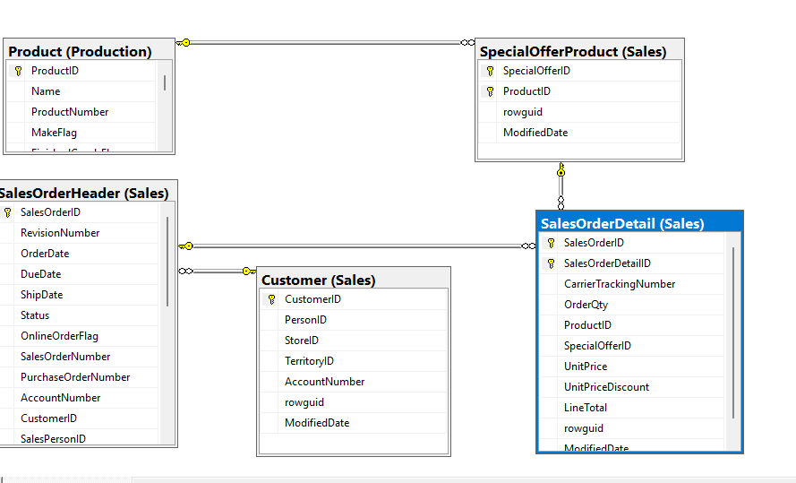

# AdventureWorks — análisis de ventas

Mini-proyecto de análisis sobre **AdventureWorks**, la base de ejemplo de Microsoft que simula una fábrica de bicicletas (Adventure Works Cycles). Se trabajó con SQL Server 2025 y Python (Pandas), respondiendo tres preguntas de negocio.

## Modelo de datos (DER)

Tablas usadas: `Sales.Customer`, `Sales.SalesOrderHeader`, `Sales.SalesOrderDetail`, `Sales.SpecialOfferProduct` y `Production.Product`. Los detalles del pedido llegan a `Product` pasando por `SpecialOfferProduct`, una tabla puente con clave compuesta (`SpecialOfferID` + `ProductID`).

## Pregunta 1: ¿quiénes compran?

`Sales.Customer` tiene **19.820 clientes**: **19.119 son personas** y **701 son tiendas** (`PersonID` nulo).

Un `JOIN` con `Person.Person` pierde las tiendas, y el `LEFT JOIN` las incluye (con nombre y apellido vacíos). Las consultas son distintas según lo que se quiera ver: solo clientes persona o todos los clientes. En esta base las personas están en una sola tabla, que incluye empleados, clientes y proveedores.

## Pregunta 2: ¿qué se vende?

Los 5 productos más baratos con precio de venta (`ListPrice > 0`):

| Producto | Precio de lista |
| --- | --- |
| Patch Kit/8 Patches | 2,29 |
| Road Tire Tube | 3,99 |
| Touring Tire Tube | 4,99 |
| Mountain Tire Tube | 4,99 |
| Water Bottle - 30 oz. | 4,99 |

De los cinco, los últimos tres tienen el mismo precio. El más barato es el Patch Kit/8 Patches, con 2,29. Son accesorios y repuestos de mantenimiento, no bicicletas. Para descartar que el empate dejara a otro producto afuera, se amplió la consulta a un top 10: se confirmó que solo esos tres cuestan 4,99 y que desde el sexto producto el precio ya era mayor.

## Pregunta 3: ¿cuánto se vendió y cuándo?

Monto por año (`OrderQty * UnitPrice * (1 - UnitPriceDiscount)`):

| Año | Monto |
| --- | --- |
| 2022 (parcial, desde fines de mayo) | 14.561.051,59 |
| 2023 | 31.604.921,95 |
| 2024 | 43.671.889,50 |
| 2025 (parcial, hasta junio) | 20.008.518,36 |
| **Total** | **109.846.381,40** |

El total coincide con la suma del monto de todas las líneas de pedido (121.317 filas).

De los cuatro años del dataset, el de mayor facturación es **2024**, que creció casi un 40% respecto de 2023. 2022 y 2025 son años parciales: la caída de más de un 50% en 2025 se debe a que solo se comparan 6 meses, y el salto de 2023 se explica en parte por la parcialidad de 2022.

## Herramientas

SQL Server 2025 (SSMS), Python, Pandas y SQLAlchemy (con pyodbc).

## Cómo correrlo

1. Restaurar la base `AdventureWorks2025` (versión OLTP, `.bak` desde Microsoft Learn) en SQL Server con SSMS.
2. Instalar las librerías: `pip install pandas sqlalchemy pyodbc`.
3. En cada script, ajustar la cadena de conexión (`create_engine`) con el nombre de tu servidor.
4. Ejecutar, por ejemplo: `python 06_order_details.py`.

## Próximos pasos

- Comparar enero a junio de 2024 contra enero a junio de 2025, para saber si 2025 realmente bajó.
- Responder cuáles son los productos más vendidos, uniendo `Product` con `SalesOrderDetail` y sumando `OrderQty`.
